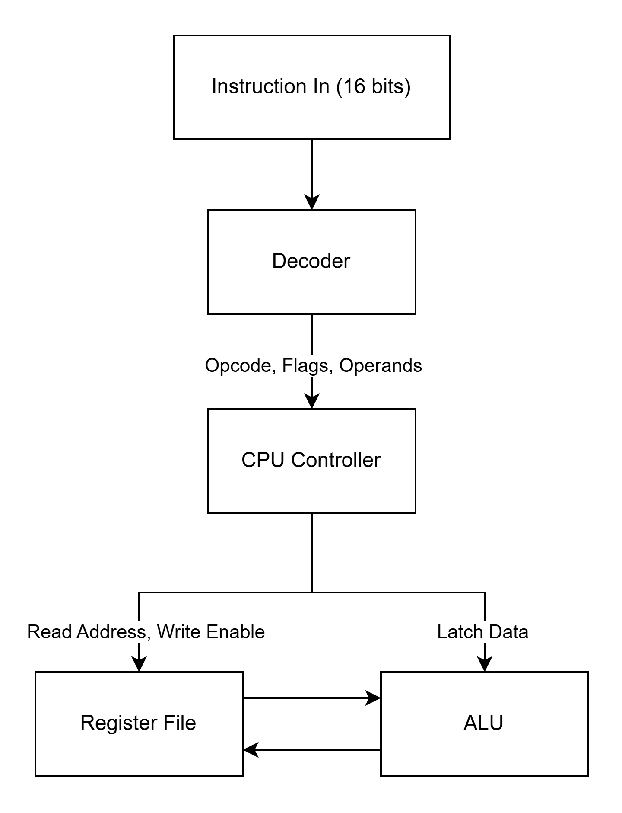
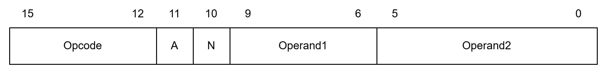

# 16-Bit RISC CPU in VHDL

A modular, synthesizable 16-Bit RISC CPU implemented in VHDL, featuring an 8-bit arithmetic datapath, a 16-register dual-port register file, a dedicated instruction decoder, and an 8-stage synchronous Finite State Machine (FSM).

## Architecture Overview

### Key Hardware Features

- Instruction Word: 16-bit instruction format supporting immediate and register-direct addressing.
- Datapath: 8-bit parallel arithmetic and logic operations.
- Storage: 16 general-purpose 8-bit registers (R0 to R15).
- FSM Sequencing: Deterministic 8-state synchronous execution cycle:
  $$\text{IDLE} \rightarrow \text{FETCH} \rightarrow \text{DECODE} \rightarrow \text{READ\_OPERAND} \rightarrow \text{READ\_ADDRESS} \rightarrow \text{EXECUTE} \rightarrow \text{WRITE} \rightarrow \text{COMPLETE}$$

## Instruction Set Architecture (ISA)

### Instruction Bitfield Format

- Opcode [15:12]: 4-bit ALU operation selector.
- Address Flag [11] (A):
  - '0': Immediate value addressing (Operand2[5:0]).
  - '1': Register-direct addressing (Operand2[5:2] selects source register).
- Negative Flag [10] (N):
  - '1': Applies two's complement negation to the result before register write-back.
- Operand 1 [9:6]: 4-bit destination register address (R0 to R15).
- Operand 2 [5:0]: 6-bit immediate value (0 to 63) or 4-bit register address ([5:2]).

### Supported Opcodes

| Opcode | Mnemonic | Name              | Operation                                                        |
| :----: | :------: | :---------------- | :--------------------------------------------------------------- |
|  0000  |   ADD    | Addition          | $R_{dest} \leftarrow R_{dest} + Operand2$                        |
|  0001  |   SUB    | Subtraction       | $R_{dest} \leftarrow R_{dest} - Operand2$                        |
|  0010  |   MUL    | Multiplication    | $R_{dest} \leftarrow (R_{dest} \times Operand2)[7:0]$            |
|  0011  |   DIV    | Division          | $R_{dest} \leftarrow R_{dest} / Operand2$ (guarded against zero) |
|  0100  |   AND    | Bitwise AND       | $R_{dest} \leftarrow R_{dest} \text{ AND } Operand2$             |
|  0101  |    OR    | Bitwise OR        | $R_{dest} \leftarrow R_{dest} \text{ OR } Operand2$              |
|  0110  |   XOR    | Bitwise XOR       | $R_{dest} \leftarrow R_{dest} \text{ XOR } Operand2$             |
|  0111  |   NOT    | Bitwise NOT       | $R_{dest} \leftarrow \text{NOT } R_{dest}$                       |
|  1000  | NEG_ADD  | Negative Addition | $R_{dest} \leftarrow R_{dest} + (\sim Operand2 + 1)$             |
|  1001  |   STOR   | Store / Move      | $R_{dest} \leftarrow Operand2$                                   |

## More Information

To read more about each component of the CPU, please refer to the following documentation files:

- [cpu](doc/cpu.md)
- [decoder](doc/decoder.md)
- [registerfile](doc/registerfile.md)
- [alu](doc/alu.md)
- [cpu_pkg](doc/cpu_pkg.md)
