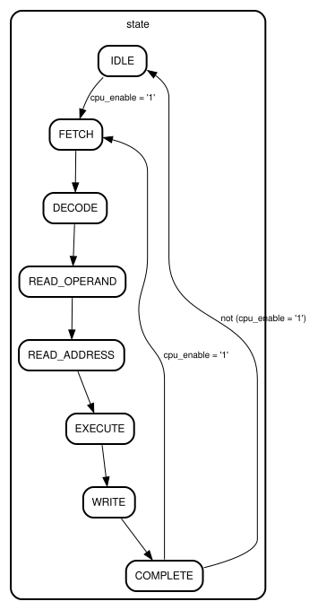

# Entity: cpu

- **File:** cpu.vhd
- **Brief:** Top-Level 16-Bit RISC CPU
- **Details:** Integrates Instruction Decoder, 16x8-bit Register File, and 8-bit ALU.

## Diagram

## Description

FSM Control Cycle:

- IDLE: Wait for cpu_enable activation
- FETCH: Latch 16-bit instruction word
- DECODE: Decode opcode, flags, and operand addresses
- READ_OPERAND: Read operands from register file
- READ_ADDRESS: Setup ALU operand inputs
- EXECUTE: Perform ALU arithmetic/logic operation
- WRITE: Write computed result back into destination register
- COMPLETE: Conclude cycle and advance

## Ports

| Port name   | Direction | Type                           | Description                               |
| ----------- | --------- | ------------------------------ | ----------------------------------------- |
| cpu_clk     | in        | STD_LOGIC                      | Master system clock input                 |
| cpu_enable  | in        | STD_LOGIC                      | Global CPU execution enable (active high) |
| cpu_reset   | in        | STD_LOGIC                      | Asynchronous system reset (active high)   |
| instruction | in        | STD_LOGIC_VECTOR (15 DOWNTO 0) | 16-bit instruction word input             |

## Signals

| Name                         | Type                          | Description                                                                            |
| ---------------------------- | ----------------------------- | -------------------------------------------------------------------------------------- |
| state                        | state_type                    | Current state of the CPU control FSM                                                   |
| program_counter              | INTEGER                       | Program counter / instruction cycle counter                                            |
| instruction_raw              | STD_LOGIC_VECTOR(15 DOWNTO 0) | Latched 16-bit instruction word                                                        |
| opcode                       | STD_LOGIC_VECTOR(3 DOWNTO 0)  | 4-bit decoded operation code                                                           |
| address_flag                 | STD_LOGIC                     | Addressing mode flag ('0' = Immediate, '1' = Register)                                 |
| negative_flag                | STD_LOGIC                     | Negative flag for two's complement writeback enable                                    |
| operand1                     | STD_LOGIC_VECTOR(3 DOWNTO 0)  | 4-bit destination register address                                                     |
| operand2                     | STD_LOGIC_VECTOR(5 DOWNTO 0)  | 6-bit operand field (immediate value or shifted source register address)               |
| write_enable_in              | STD_LOGIC                     | Synchronous register file write enable control ('1' = write, '0' = read)               |
| register_addr_dest_data_in   | STD_LOGIC_VECTOR(3 DOWNTO 0)  | 4-bit destination register address driven to register file                             |
| register_addr_src_data_in    | STD_LOGIC_VECTOR(3 DOWNTO 0)  | 4-bit source register address driven to register file                                  |
| register_value_dest_data_in  | STD_LOGIC_VECTOR(7 DOWNTO 0)  | 8-bit data written back into destination register                                      |
| register_value_src_data_in   | STD_LOGIC_VECTOR(7 DOWNTO 0)  | 8-bit secondary data input to register file                                            |
| register_value_dest_data_out | STD_LOGIC_VECTOR(7 DOWNTO 0)  | 8-bit data read out from destination register                                          |
| register_value_src_data_out  | STD_LOGIC_VECTOR(7 DOWNTO 0)  | 8-bit data read out from source register                                               |
| alu_enable                   | STD_LOGIC                     | ALU operation enable control ('1' = compute)                                           |
| input1                       | STD_LOGIC_VECTOR(7 DOWNTO 0)  | 8-bit primary operand input to ALU (destination register data)                         |
| input2                       | STD_LOGIC_VECTOR(7 DOWNTO 0)  | 8-bit secondary operand input to ALU (source register data or zero-extended immediate) |
| alu_result1                  | STD_LOGIC_VECTOR(7 DOWNTO 0)  | 8-bit primary result output from ALU                                                   |
| alu_result2                  | STD_LOGIC_VECTOR(7 DOWNTO 0)  | 8-bit secondary passthrough result from ALU                                            |

## Processes

- fsm_process
  - Has a sensitivity list of cpu_clk and cpu_reset
  - Main CPU control FSM and datapath sequencing process

## Instantiations

- cpu_registerfile: registerfile
  - Dual-port 16x8-bit general purpose register file instance
- cpu_decoder: decoder
  - 16-bit instruction word decoder instance
- cpu_alu: alu
  - 8-bit arithmetic logic unit (ALU) instance

## State machines

